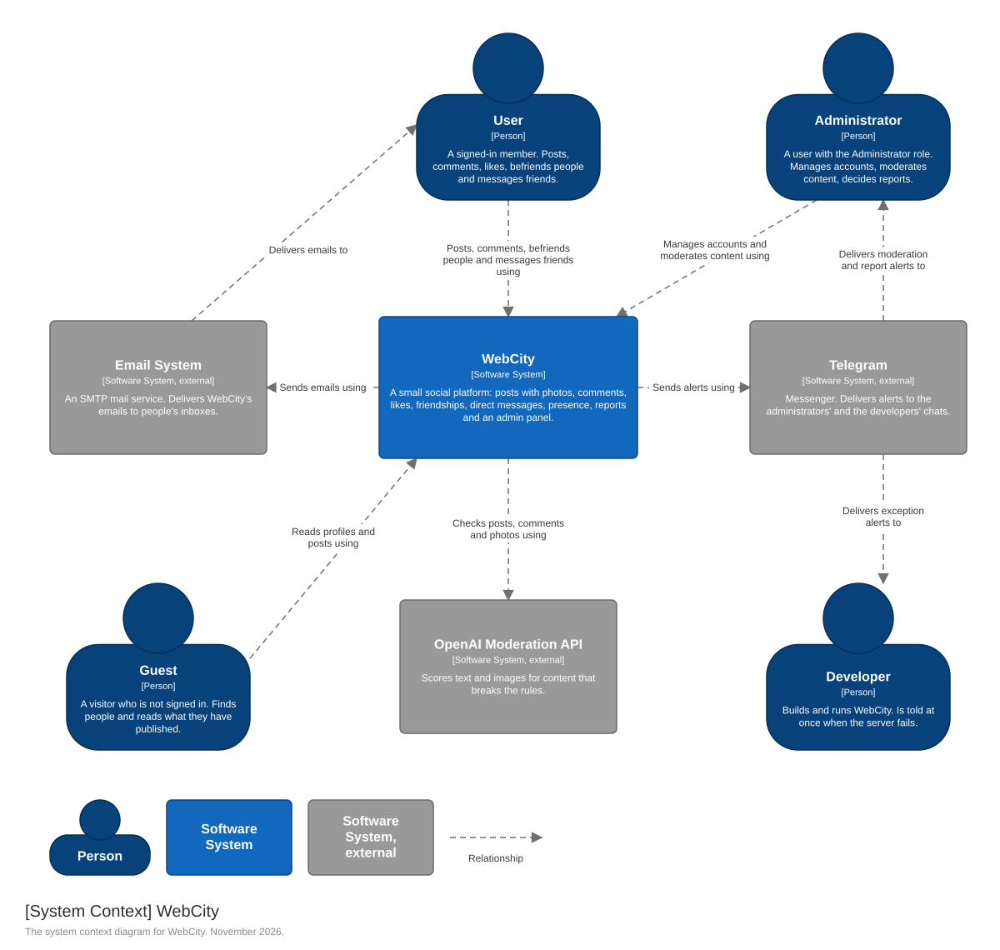
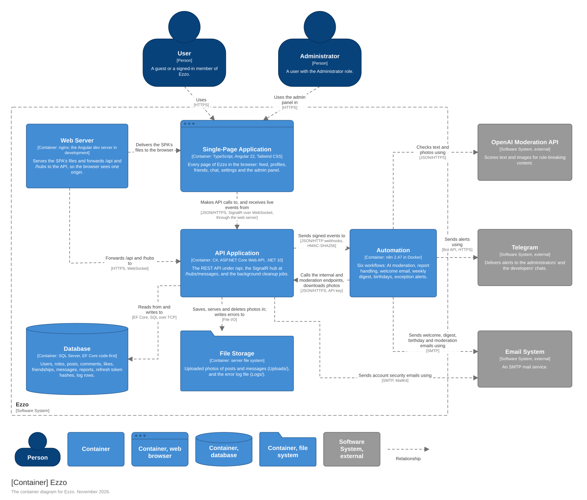
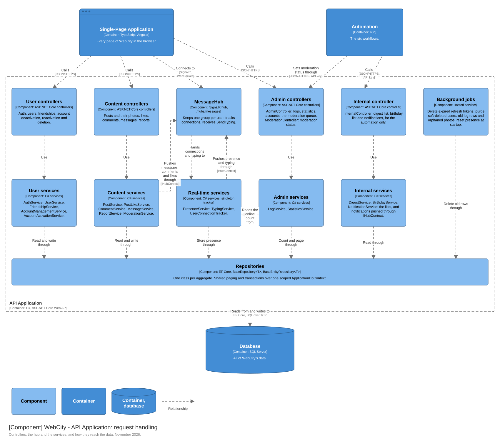
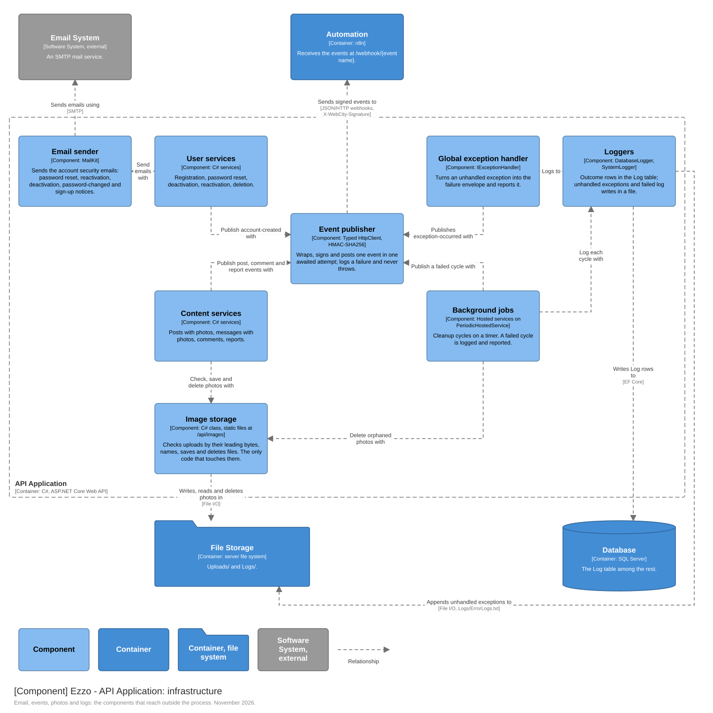
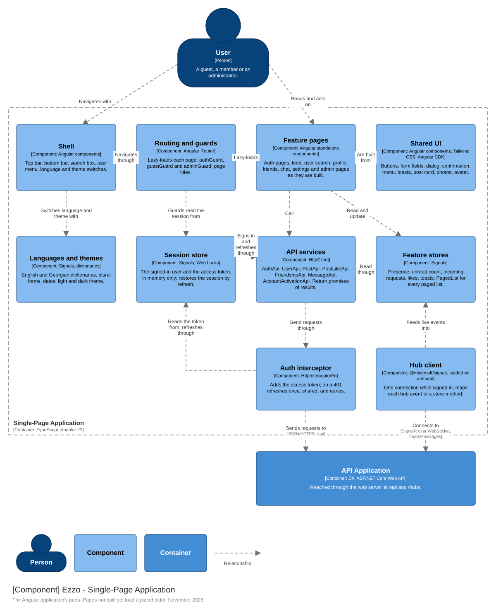
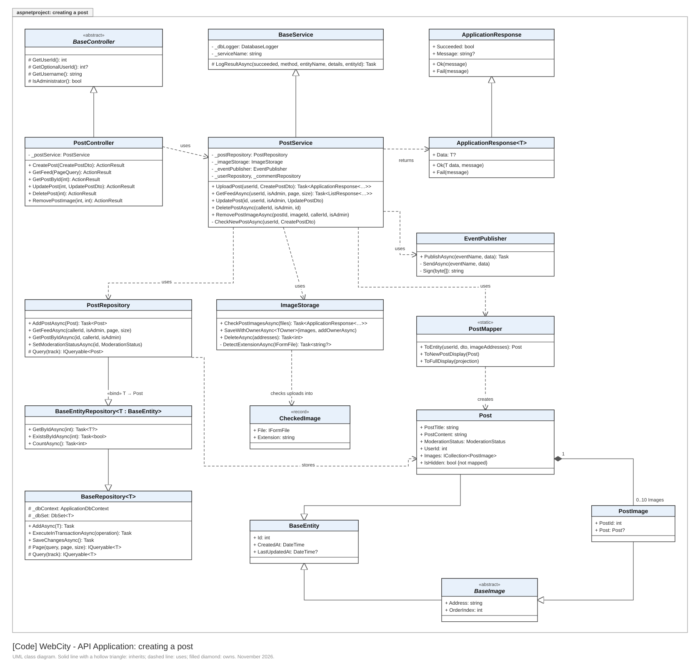

# WebCity — პროგრამული უზრუნველყოფის არქიტექტურა (C4 მოდელი)

მდგომარეობა: 2026 წლის 20 ნოემბერი

## შესავალი

ეს დოკუმენტი აღწერს WebCity-ის არქიტექტურას C4 მოდელის ოთხ დონეზე: სისტემის კონტექსტი, კონტეინერები, კომპონენტები და კოდი. თითოეული დონე წინას „ზუმავს“: კონტექსტის დიაგრამა სისტემას ერთ ყუთად აჩვენებს მის მომხმარებლებსა და გარე სისტემებს შორის, კონტეინერის დიაგრამა ამ ყუთს ცალკე გაშვებად ნაწილებად ყოფს, კომპონენტის დიაგრამები ერთი კონტეინერის შიგნით არსებულ ფუნქციურ ნაწილებს აჩვენებს, ხოლო კოდის დიაგრამა ერთი კომპონენტის კლასებს.

WebCity მცირე სოციალური პლატფორმაა: პოსტები ფოტოებით, კომენტარები, მოწონებები, მეგობრობა, პირადი შეტყობინებები, ონლაინ სტატუსი, რეპორტები და ადმინისტრატორის პანელი.

დიაგრამების წარწერები ინგლისურადაა, რადგან ასეთივეა კოდში არსებული სახელები; განმარტებები ქართულადაა. აღნიშვნები (ფერები და ფორმები) C4 მოდელის სტანდარტულ სტილს მიჰყვება და ყოველი დიაგრამის ქვემოთ, ლეგენდაშია ნაჩვენები.

### პროექტის მიმდინარე მდგომარეობა

დიაგრამები აჩვენებს სისტემის სრულ არქიტექტურას. ცხრილში მითითებულია, რომელი ნაწილია რეალიზებული და რომელი რეალიზაციის პროცესშია. კომპონენტის დიაგრამებზე დაგეგმილი კომპონენტები წყვეტილი კონტურით არის მონიშნული.

| ნაწილი | მდგომარეობა |
|---|---|
| API Application (backend) | აშენებულია: ყველა endpoint, SignalR hub, background job-ები, ფოტოების შენახვა, ელფოსტა, ავტომატიზაციისთვის მოვლენების გაგზავნა. დარჩენილია: ავტომატიზაციის API key, შიდა (internal) endpoint-ები, digest-ის გადამრთველი |
| Database | აშენებულია (EF Core migration-ები) |
| File Storage | აშენებულია |
| Single-Page Application | აშენებულია: გარსი (shell), ავტორიზაციის გვერდები, feed, მომხმარებლების ძიება, ადმინისტრატორის მომხმარებლების სია, ორი ენა, ორი თემა, live კავშირი. დანარჩენი გვერდები მზადდება; მანამდე მათ მისამართზე დროებითი გვერდი იტვირთება |
| Automation (n8n) | backend-ის მხარე მზადაა (ხელმოწერილი მოვლენები). თავად n8n და მისი ექვსი workflow მზადდება |
| Web Server | development-ში ამ როლს Angular-ის dev server-ი ასრულებს; production-ის nginx კონფიგურაცია ჯერ არ არის |

---

## 1. სისტემის კონტექსტის დიაგრამა



კონტექსტის დიაგრამა აჩვენებს WebCity-ს მთლიანად, როგორც ერთ სისტემას: ვინ იყენებს მას და რომელ გარე სისტემებს ეყრდნობა. აქ ტექნოლოგიები და შიდა აგებულება არ ჩანს; დიაგრამა არატექნიკური მკითხველისთვისაც გასაგებია.

### ადამიანები

| ელემენტი | აღწერა |
|---|---|
| Guest (სტუმარი) | არაავტორიზებული ვიზიტორი. შეუძლია მომხმარებლების მოძებნა და მათი გამოქვეყნებული პოსტებისა და პროფილების ნახვა, მაგრამ არა მოქმედება (პოსტი, მოწონება, კომენტარი, რეპორტი, მეგობრობა, მიმოწერა) |
| User (მომხმარებელი) | ავტორიზებული წევრი. აქვეყნებს, აკომენტარებს, იწონებს, იმეგობრებს და მეგობრებს წერს |
| Administrator (ადმინისტრატორი) | მომხმარებელი Administrator როლით. მართავს ანგარიშებს, ცვლის კონტენტის მოდერაციის სტატუსს, განიხილავს რეპორტებს, კითხულობს ლოგებსა და სტატისტიკას. ადმინისტრატორი ამავდროულად ჩვეულებრივი მომხმარებელიცაა |
| Developer (დეველოპერი) | ქმნის და უშვებს სისტემას. სერვერზე მოულოდნელი შეცდომის შესახებ მაშინვე იგებს Telegram-ით |

### სისტემები

| ელემენტი | ტიპი | აღწერა |
|---|---|---|
| WebCity | ჩვენი სისტემა | სოციალური პლატფორმა მთლიანად: ვებ-აპლიკაცია, API, მონაცემთა ბაზა და ავტომატიზაცია |
| Email System | გარე | SMTP სერვისი, რომლითაც WebCity ელფოსტას აგზავნის: ანგარიშის უსაფრთხოების წერილები, მისალმება, ყოველკვირეული digest, დაბადების დღეები, მოდერაციის შეტყობინებები ადმინისტრატორებისთვის |
| Telegram | გარე | ადმინისტრატორების ჩატში აგზავნის მოდერაციისა და რეპორტების შეტყობინებებს (alert), დეველოპერების ჩატში კი სერვერის შეცდომებს |
| OpenAI Moderation API | გარე | აფასებს პოსტების, კომენტარებისა და ფოტოების შინაარსს წესების დარღვევაზე. პირადი შეტყობინებები მას არასოდეს ეგზავნება |

---

## 2. კონტეინერის დიაგრამა



კონტეინერი არის ცალკე გაშვებადი ნაწილი, რომელიც კოდს ასრულებს ან მონაცემებს ინახავს. დიაგრამა აჩვენებს, რა ნაწილებისგან შედგება WebCity, რა ტექნოლოგიითაა თითოეული აგებული და როგორ ურთიერთობენ ისინი.

| კონტეინერი | ტექნოლოგია | პასუხისმგებლობა |
|---|---|---|
| Web Server | nginx (production), Angular dev server (development) | ბრაუზერს აწვდის SPA-ის ფაილებს და `/api` და `/hubs` მისამართებს API-ს გადასცემს |
| Single-Page Application | TypeScript, Angular 22, Tailwind CSS, Angular CDK | WebCity-ის ყველა გვერდი ბრაუზერში: feed, პროფილები, მეგობრები, ჩატი, პარამეტრები, ადმინისტრატორის პანელი. ინტერფეისი ინგლისურ და ქართულ ენებზე, ღია და მუქი თემით |
| API Application | C#, ASP.NET Core Web API, .NET 10, EF Core, SignalR, MailKit | მთელი ბიზნეს-ლოგიკა: REST API `/api`-ზე, SignalR hub `/hubs/messages`-ზე, JWT ავტორიზაცია, rate limiting, background job-ები |
| Database | SQL Server, EF Core code-first migration-ები | მომხმარებლები, როლები, პოსტები და მათი ფოტოების მისამართები, კომენტარები, მოწონებები, მეგობრობა, შეტყობინებები, რეპორტები, refresh token-ების hash-ები, ლოგები |
| File Storage | სერვერის ფაილური სისტემა | ატვირთული ფოტოები (`Uploads/`) და მოულოდნელი შეცდომების ლოგ-ფაილი (`Logs/`) |
| Automation | n8n 2.47, Docker | ექვსი workflow: AI მოდერაცია, რეპორტების დამუშავება, მისალმების ელფოსტა, ყოველკვირეული digest, დაბადების დღეები, შეცდომების შეტყობინებები |

### არქიტექტურული თავისებურებები

- **ერთი origin.** Refresh token ინახება `HttpOnly; Secure; SameSite=Strict` cookie-ში, რომელსაც ბრაუზერი მხოლოდ იმავე საიტზე აგზავნის. ამიტომ ბრაუზერი SPA-საც და API-საც ერთი მისამართიდან ხედავს: web server-ი SPA-ის ფაილებს თავად აწვდის, `/api` და `/hubs` კი API-ს გადასცემს. SPA მხოლოდ ფარდობით მისამართებს იძახებს.
- **Real-time კავშირი.** SPA ავტორიზაციის შემდეგ SignalR-ით (WebSocket) უკავშირდება hub-ს და იღებს ახალ შეტყობინებებს, კომენტარებს, მოწონებებს, მეგობრების ონლაინ სტატუსს და „typing“ სიგნალს. Hub-თან კავშირისას JWT query string-ით გადაეცემა.
- **ელფოსტის ორი გამგზავნი.** ყველა წერილს, რომელიც საიდუმლოს შეიცავს ან რომლის დაკარგვაც მომხმარებელს ანგარიშის დაკარგვად შეიძლება დაუჯდეს (პაროლის აღდგენა, ანგარიშის აღდგენა, დეაქტივაცია და სხვ.), API თავად აგზავნის MailKit-ით. მისალმებას, digest-ს, დაბადების დღეებსა და მოდერაციის წერილს Automation აგზავნის.
- **API → Automation.** API მნიშვნელოვან მოვლენებს (ახალი ანგარიში, პოსტი, კომენტარი, მათი რედაქტირება, რეპორტი, მოულოდნელი exception) n8n-ის webhook-ებზე აგზავნის, HMAC-SHA256-ით ხელმოწერილს (`X-WebCity-Signature` header). მცდელობა ერთია, 3 წამიანი ლიმიტით; ჩავარდნა მხოლოდ ლოგში იწერება და მომხმარებლის მოთხოვნაზე გავლენას არ ახდენს. მოვლენა არასოდეს შეიცავს ტოკენს, პაროლს ან hash-ს.
- **Automation → API.** n8n API-ს საკუთარი გასაღებით (`X-Api-Key`) მიმართავს. გასაღები ხსნის მხოლოდ შიდა endpoint-ებს (`/api/internal/*`: digest-ის სია, დაბადების დღეების სია, შეტყობინებების გაგზავნა) და მოდერაციის ორ endpoint-ს, სადაც ავტომატიზაციას შეუძლია კონტენტის მხოლოდ Flagged ან Hidden სტატუსზე გადაყვანა. ფოტოებს მოდერაციისთვის `/api/images/*` მისამართიდან კითხულობს.
- **ფოტოები ფაილურ სისტემაში.** ბაზაში მხოლოდ ფოტოს ფარდობითი მისამართი (`/api/images/{name}`) იწერება; ფაილებს API static file-ებად აწვდის.
- ელფოსტისა და Telegram-ის მიერ ადამიანებისთვის წერილების მიწოდება ნაჩვენებია კონტექსტის დიაგრამაზე და აქ, სიმარტივისთვის, გამოტოვებულია.

---

## 3. კომპონენტის დიაგრამები

კომპონენტი არის ერთ ინტერფეისს მიღმა გაერთიანებული ფუნქციების ნაკრები. ყველა კომპონენტი თავისი კონტეინერის ერთ პროცესში მუშაობს. აქ ორი კონტეინერია დაშლილი: API Application და Single-Page Application. API Application ორ ხედადაა წარმოდგენილი: პირველი აჩვენებს მოთხოვნის დამუშავებას, მეორე კი კომპონენტებს, რომლებიც პროცესის გარეთ არსებულ სისტემებს უკავშირდება (ელფოსტა, მოვლენები, ფაილები, ლოგები).

### 3ა. API Application: მოთხოვნის დამუშავება



დამოკიდებულებები ერთი მიმართულებით მიდის: **Controllers / Hub → Services → Repositories → ApplicationDbContext**. საქაღალდეები დომენის მიხედვითაა დაჯგუფებული (`Users`, `Content`) და ეს დაჯგუფება ყველა ფენაში მეორდება.

| კომპონენტი | შემადგენლობა | პასუხისმგებლობა |
|---|---|---|
| User controllers | `AuthController`, `UserController`, `FriendshipController`, `AccountManagementController`, `AccountActivationController` | რეგისტრაცია, შესვლა, ტოკენის განახლება, პაროლის აღდგენა, პროფილები, ძიება, მეგობრობა, ანგარიშის დეაქტივაცია, აღდგენა და წაშლა |
| Content controllers | `PostController`, `PostLikeController`, `CommentController`, `MessageController`, `ReportController` | პოსტები და მათი ფოტოები, მოწონებები, კომენტარები, შეტყობინებები, რეპორტები |
| MessageHub | SignalR hub | თითო მომხმარებელს თავისი ჯგუფი აქვს; hub აღრიცხავს კავშირებს და იღებს `SendTyping` გამოძახებას. თავად არაფერს ამოწმებს |
| Admin controller | `AdminController` | ლოგები, სტატისტიკა, ანგარიშების სია, მოდერაციის სტატუსი და მოდერაციის რიგი |
| Internal controller (დაგეგმილი) | | digest-ისა და დაბადების დღეების სიები და შეტყობინებების გაგზავნა; მხოლოდ ავტომატიზაციისთვის |
| Background jobs | `RefreshTokenCleanupService`, `SoftDeletedUsersCleanupService`, `OldLogsCleanupService`, `OrphanImagesCleanupService`, `PresenceResetService` | ვადაგასული refresh token-ების, ძველი ლოგების და ობოლი ფოტოების წაშლა; წაშლილი ანგარიშების საბოლოო გასუფთავება retention-ის ვადის შემდეგ; გაშვებისას ყველას ოფლაინად მონიშვნა |
| User services | `AuthService`, `UserService`, `FriendshipService`, `AccountManagementService`, `AccountActivationService` და დამხმარეები (`PasswordHasher`, `TokenGenerator`, `AccountSecurityService`, `UrlSecurityService`) | მომხმარებლებისა და ანგარიშების ბიზნეს-ლოგიკა |
| Content services | `PostService`, `PostLikeService`, `CommentService`, `MessageService`, `ReportService`, `ModerationService` | კონტენტის ბიზნეს-ლოგიკა; live მოვლენებს `IHubContext`-ით იმავე მეთოდში აგზავნის, რომელიც მონაცემს ცვლის |
| Real-time services | `PresenceService`, `TypingService`, `UserConnectionTracker` (singleton) | ონლაინ/ოფლაინ სტატუსი მეგობრებისთვის და „typing“ სიგნალი |
| Admin services | `LogService`, `StatisticsService` | ლოგების გვერდებად წაკითხვა და სისტემის სტატისტიკა |
| Internal services (დაგეგმილი) | | digest-ისა და დაბადების დღეების სიების აგება, შეტყობინებების გაგზავნა hub-ით |
| Repositories | `BaseRepository<T>`, `BaseEntityRepository<T>` და თითო კლასი ყოველ aggregate-ზე | მონაცემებზე წვდომა EF Core-ით; საერთო pagination და ტრანზაქციები ერთ scoped `ApplicationDbContext`-ზე |

ხედზე არ ჩანს, მაგრამ ყველა მოთხოვნაზე ვრცელდება:

- **ავტორიზაცია და rate limiting.** JWT bearer ავტორიზაცია (ავტომატიზაციისთვის დამატებით API key scheme), შემდეგ rate limiter, შემდეგ authorization. Rate limiter ავტორიზაციის შემდეგ დგას, ამიტომ შესვლამდე მოთხოვნები IP მისამართით ითვლება, შესვლის შემდეგ კი მომხმარებლით.
- **შედეგის wrapper.** სერვისი, რომელიც შეიძლება ჩავარდეს, აბრუნებს `ApplicationResponse` ან `ApplicationResponse<T>`-ს, ხოლო controller-ი მის `Succeeded`-ს HTTP სტატუსად გარდაქმნის.
- **ინტერფეისების გარეშე.** Repository-ები, სერვისები და mapper-ები კონკრეტული კლასებია, პირდაპირ რეგისტრირებული (`ApplicationServicesExtensions`).
- **DTO-ები.** პასუხები სამ დონედაა (Minimal, Standard, Full) და მათ სტატიკური mapper-ები აგებენ; entity კლიენტს არასოდეს უბრუნდება.
- **ანგარიშის მდგომარეობები.** `User`-ზე გლობალური query filter-ი დეაქტივირებულ და წაშლილ მომხმარებლებს ჩვეულებრივი წაკითხვებიდან მალავს.

### 3ბ. API Application: ინფრასტრუქტურა



| კომპონენტი | ტექნოლოგია | პასუხისმგებლობა |
|---|---|---|
| Email sender | MailKit, SMTP | ანგარიშის უსაფრთხოების წერილები: პაროლის აღდგენა, ანგარიშის აღდგენა, „ვიღაცამ თქვენი ელფოსტით რეგისტრაცია სცადა“, „პაროლი შეიცვალა“, დეაქტივაცია, აღდგენა |
| Event publisher | typed `HttpClient`, HMAC-SHA256 | მოვლენას ფუთავს (envelope), ხელს აწერს და ერთი მცდელობით აგზავნის. არასოდეს აგდებს exception-ს: ჩავარდნა მხოლოდ `Log` ცხრილში იწერება |
| Global exception handler | `IExceptionHandler` | მოულოდნელ exception-ს კლიენტისთვის სტანდარტულ პასუხად გარდაქმნის შიდა დეტალების გარეშე, ლოგავს და `exception-occurred` მოვლენას აგზავნის |
| Loggers | `DatabaseLogger`, `SystemLogger` | ყოველი სერვისის მოქმედების შედეგი იწერება `Log` ცხრილში (`BaseService.LogResultAsync`); მოულოდნელი exception-ები და ლოგის ჩაწერის ჩავარდნა ფაილში |
| Image storage | C# კლასი, static files `/api/images`-ზე | ფოტოს ამოწმებს შინაარსის პირველი ბაიტებით (JPEG, PNG, WebP), თავად არქმევს სახელს, ინახავს და შლის. ერთადერთი კოდია, რომელიც ფაილებს ეხება, ამიტომ cloud storage-ზე გადასვლა მხოლოდ ამ კლასს შეცვლის |
| User services, Content services, Background jobs | | იგივე კომპონენტები, რაც 3ა ხედზე; აქ ნაჩვენებია მხოლოდ მათი კავშირები ინფრასტრუქტურასთან |

ყველა სერვისი `BaseService`-ს მემკვიდრეა და შედეგს `DatabaseLogger`-ით წერს; ეს ისრები სიმარტივისთვის არ არის დახატული.

### 3გ. Single-Page Application



| კომპონენტი | ტექნოლოგია | პასუხისმგებლობა |
|---|---|---|
| Shell | Angular კომპონენტები | ზედა და ქვედა ზოლი, ძიების ველი, მომხმარებლის მენიუ, ენისა და თემის გადამრთველები; კომპიუტერზე, ტელეფონზე და სტუმრისთვის |
| Routing and guards | Angular Router | ყოველი გვერდი საჭიროებისამებრ (lazy) იტვირთება; `authGuard`, `guestGuard`, `adminGuard`; გვერდის სათაურები |
| Feature pages | Angular standalone კომპონენტები | ფუნქციური გვერდები (`features/`): ავტორიზაცია, feed, ძიება, პროფილი, მეგობრები, ჩატი, პარამეტრები, ადმინისტრატორის პანელი |
| Shared UI | Angular კომპონენტები, Tailwind CSS, Angular CDK | საერთო ელემენტები: ღილაკები, ფორმის ველები, დიალოგი, დადასტურება, მენიუ, toast-ები, პოსტის ბარათი, ფოტოები, პროფილის სურათი |
| Languages and themes | signals, ლექსიკონები | ინგლისური და ქართული ლექსიკონი, მრავლობითის ფორმები, თარიღები; ღია და მუქი თემა. სერვერის ტექსტები ინგლისურად რჩება |
| Session store | signals, Web Locks API | ავტორიზებული მომხმარებელი და access token, მხოლოდ მეხსიერებაში. გვერდის ჩატვირთვისას სესია refresh cookie-თი აღდგება; რამდენიმე ჩანართი refresh-ს lock-ით რიგრიგობით აკეთებს |
| API services | `HttpClient` | თითო კლასი თითო backend-ის სფეროზე (`AuthApi`, `UserApi`, `PostApi`, ...). აბრუნებს Promise-ს შედეგით, exception-ის ნაცვლად |
| Feature stores | signals | ცენტრალიზებული მდგომარეობა: მეგობრების ონლაინ სტატუსი, წაუკითხავი საუბრები, შემოსული მოთხოვნები, მოწონებები, toast-ები; `PagedList` ყველა გვერდებად ჩატვირთულ სიაზე |
| Auth interceptor | `HttpInterceptorFn` | ყოველ `/api` მოთხოვნას access token-ს ამატებს; 401-ზე ერთხელ ანახლებს ტოკენს (ერთი განახლება ყველა პარალელური მოთხოვნისთვის) და მოთხოვნას იმეორებს |
| Hub client | `@microsoft/signalr`, საჭიროებისამებრ ჩატვირთული | ერთი კავშირი, სანამ მომხმარებელი ავტორიზებულია; hub-ის ყოველ მოვლენას შესაბამისი store-ის მეთოდს გადასცემს. ბიბლიოთეკა პირველ ჩატვირთვაში არ შედის, ამიტომ სტუმარი მას საერთოდ არ ტვირთავს |

Hub client კავშირს Session store-ის მიხედვით ხსნის და ხურავს და ტოკენსაც იქიდან იღებს; ეს ისარი სიმარტივისთვის არ არის დახატული.

---

## 4. კოდის დიაგრამა



კოდის დონე აჩვენებს, როგორ არის კომპონენტი კლასებით რეალიზებული. მაგალითად აღებულია პოსტის შექმნა, რადგან ის ერთად აჩვენებს ფენებს, შედეგის wrapper-ს, ფაილების შენახვასა და ავტომატიზაციისთვის მოვლენის გაგზავნას. კლასებისა და მეთოდების სახელები რეალურია; ნაჩვენებია მხოლოდ ამ შემთხვევისთვის მნიშვნელოვანი წევრები.

აღნიშვნები UML-ისაა: უწყვეტი ხაზი ცარიელი სამკუთხედით არის მემკვიდრეობა, წყვეტილი ხაზი ისრით არის გამოყენება (dependency), შევსებული რომბი კი ფლობა (composition). `+` public წევრია, `#` protected, `-` private.

`POST /api/posts` მოთხოვნის გზა (`multipart/form-data`: სათაური, ტექსტი, ფოტოები):

1. `PostController.CreatePost` მომხმარებლის id-ს `BaseController.GetUserId()`-ით იღებს და `PostService.UploadPost`-ს იძახებს. თავად არაფერს ამოწმებს და არ ლოგავს.
2. `PostService.CheckNewPostAsync` ამოწმებს, რომ ავტორი არსებობს, პოსტს აქვს სათაური და ტექსტი ან ფოტო მაინც, შემდეგ კი `ImageStorage.CheckPostImagesAsync`-ით ფოტოებს: რაოდენობა (ნაგულისხმევად არაუმეტეს 10), ზომა და ფორმატი პირველი ბაიტებით. შედეგი `CheckedImage` ჩანაწერების სიაა.
3. `ImageStorage.SaveWithOwnerAsync` ფაილებს ინახავს და მიღებულ მისამართებს გადასცემს ფუნქციას, რომელიც `PostMapper.ToEntity`-ით `Post`-ს აგებს და `PostRepository.AddPostAsync`-ით ბაზაში წერს. თუ ბაზაში ჩაწერა ჩავარდა, ფაილები იშლება, ასე რომ ობოლი ფოტო არ რჩება.
4. ჩაწერის შემდეგ `EventPublisher.PublishAsync` ავტომატიზაციას `post-created` მოვლენას უგზავნის (AI მოდერაციისთვის).
5. `PostMapper.ToNewPostDisplay` აგებს DTO-ს და სერვისი აბრუნებს `ApplicationResponse<StandardPostDisplayDto>`-ს. ჩავარდნისას სერვისი `Fail`-ს უწოდებს და შედეგს `BaseService.LogResultAsync`-ით ლოგავს; controller-ი `Succeeded`-ს 201 ან 400 სტატუსად გარდაქმნის.

`PostRepository` მემკვიდრეობით იღებს `BaseEntityRepository<Post>`-ს (id-ით ოპერაციები) და `BaseRepository<T>`-ს (pagination, ტრანზაქციები, საერთო `ApplicationDbContext`). `Post` პირდაპირ, ხოლო `PostImage` `BaseImage`-ის გავლით `BaseEntity`-ის მემკვიდრეა (`Id`, `CreatedAt`, `LastUpdatedAt`); ერთ პოსტს 0-დან 10-მდე ფოტო ეკუთვნის.

---

## დიაგრამების განახლება

დიაგრამები კოდითაა აღწერილი (`docs/c4/diagrams/`) და ხელახლა იგება ერთი ბრძანებით, repo-ს root-იდან:

```bash
node docs/c4/diagrams/build.mjs
```

ბრძანება წერს SVG ფაილებს, ხოლო თუ Playwright დაყენებულია, PNG-ებსაც. ელემენტის ან ისრის შეცვლა `build.mjs`-სა (დონეები 1–2), `components.mjs`-სა (დონე 3) ან `code-diagram.mjs`-ში (დონე 4) ხდება.

PDF ვერსია (`docs/c4/webcity-c4.pdf`) ამ ფაილიდან იგება; ამას pandoc და Playwright სჭირდება:

```bash
node docs/c4/build-pdf.mjs
```
